<p align="center">
  <picture>
    <source media="(prefers-color-scheme: dark)" srcset="assets/logo.svg">
    <source media="(prefers-color-scheme: light)" srcset="assets/logo.svg">
    
  </picture>
</p>

Sofa Launcher turns a Linux living-room PC into a **Smart TV you control from the sofa**. It is a full-screen launcher driven entirely by a remote control (a SofaBaton U1 through a Flirc receiver): open and switch between streaming services and desktop apps, show a camera or a second app in the corner, and never reach for a keyboard or mouse.

**Smart TV launcher** | **Remote controlled** | **Steam games** | **Screen-in-screen** | **Home Assistant cameras** | **Linux / KDE Plasma** | **Electron + Svelte**


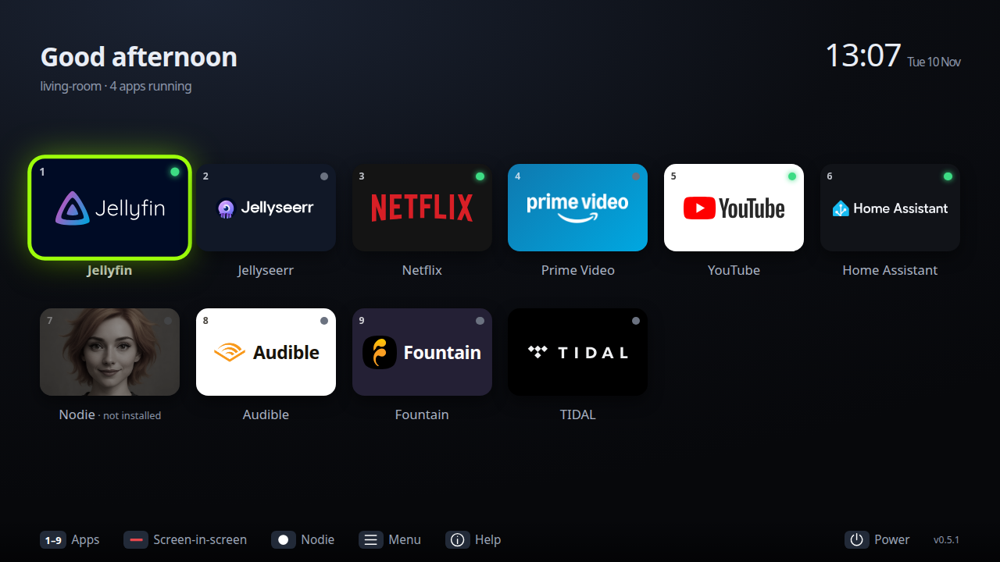

## Features

- **Everything from the remote**: arrows, OK, Back, Home, Menu, the number keys and the colour buttons all do something sensible, in the launcher and inside each app.
- **Streaming and desktop apps side by side**: Netflix, Prime Video, YouTube (its TV interface), Disney+, BBC iPlayer, Spotify, TIDAL, Audible and Fountain as browser apps; the full Microsoft Edge browser for general browsing; Jellyfin Desktop and Nod.ie as desktop apps; your own in `config.toml`.
- **Edit home screen with the remote**: show or hide any app, game or camera from a grid of tiles, without touching `config.toml`.
- **Games row**: the logged-in user's installed Steam games appear on the home screen automatically, with Steam's artwork, next to games you add yourself (such as Roblox).
- **Screen-in-screen**: put one app or a Home Assistant camera in a corner over another, move and resize it, and switch which one the remote controls.
- **Docker at a glance**: a Docker tile opens a full-screen view of every container on the TV PC, grouped by stack, with an icon and a red/amber/green status each (read-only).
- **Slide-up menu while watching**: switch app, close it, open the on-screen keyboard or the remote pointer, without leaving what is playing.
- **Back that behaves like a TV**: Back goes back inside the app, and from the app's first page returns to the launcher with the app left running.
- **Two themes and eighteen backgrounds**, chosen with the remote from a grid of thumbnails.
- **Built-in help**: a picture of the remote showing what each button does right now, and a button test for setting up a new remote.
- **Sandboxed install**: a Debian package under `/opt/sofa-launcher` with an AppArmor profile; settings and autostart belong to the TV user.

## Screenshots

All taken from the real app in demo mode (`npm run screenshot`).

| Background picker | Settings | Screen-in-screen chooser |
|---|---|---|
| 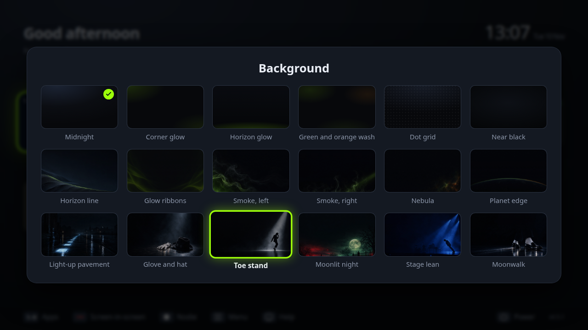 | 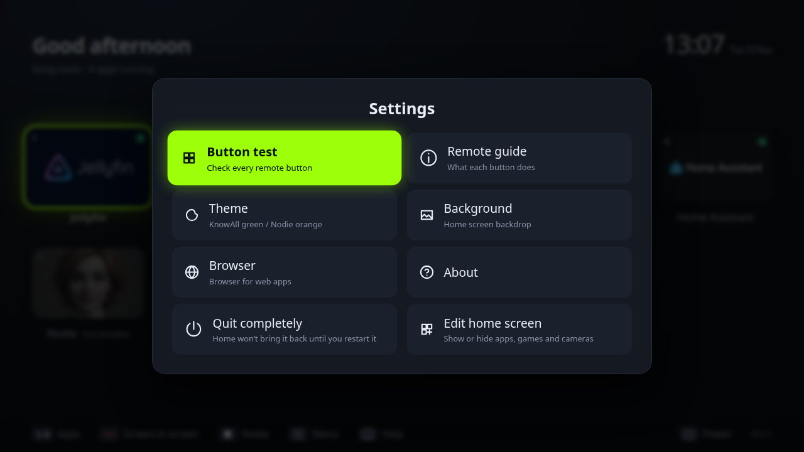 | 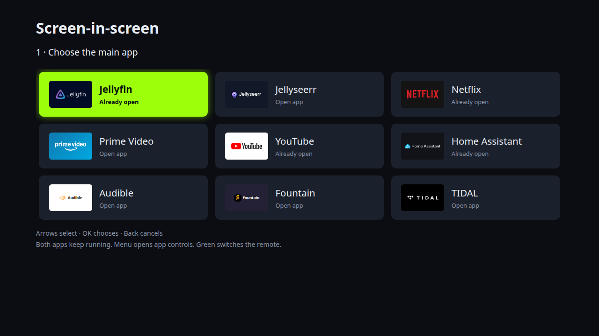 |

| Remote guide | Power menu |
|---|---|
| 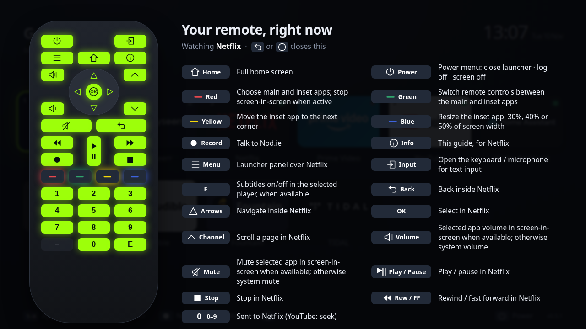 | 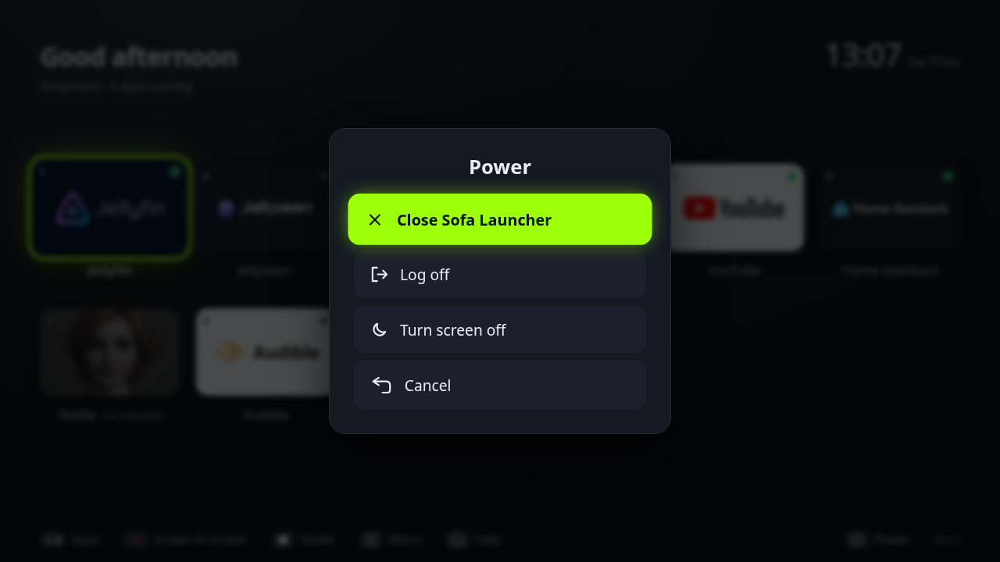 |

| Games row | Apps, games and cameras | Slide-up menu while watching |
|---|---|---|
| 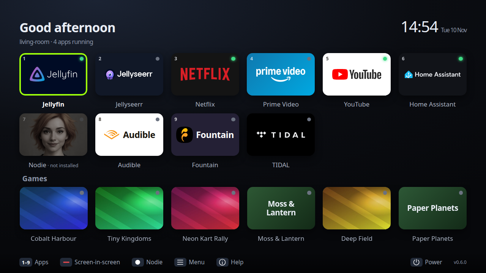 | 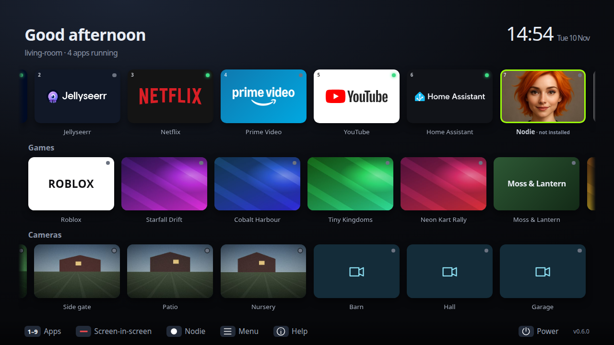 | 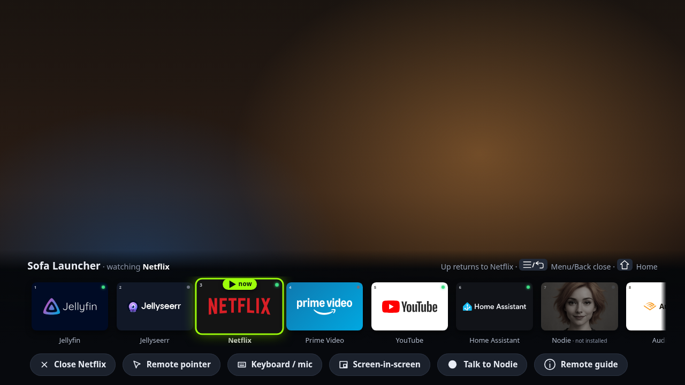 |

| Edit home screen |
|---|
| 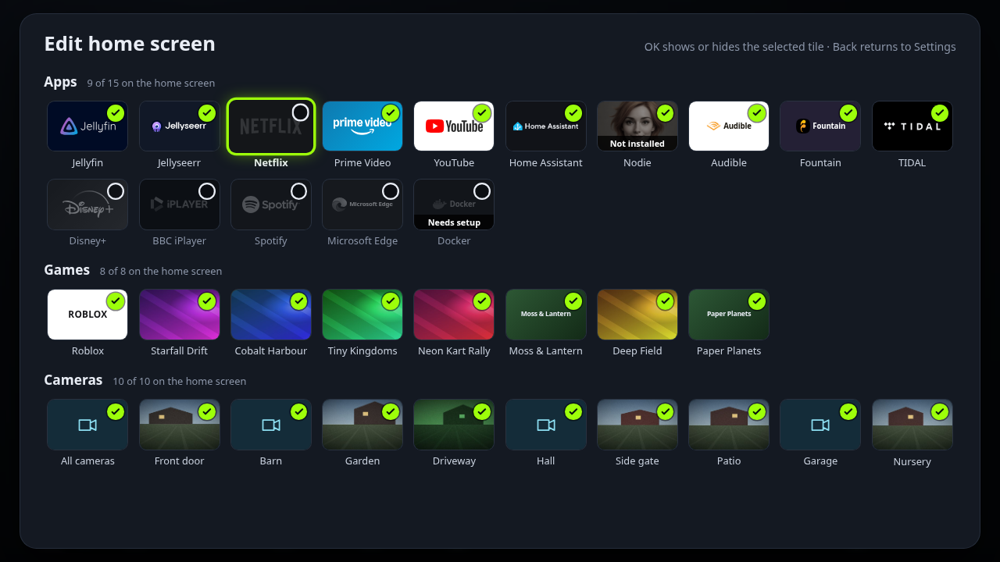 |

| KnowAll green, Planet edge background | Nod.ie orange, Horizon glow background | Button test |
|---|---|---|
| 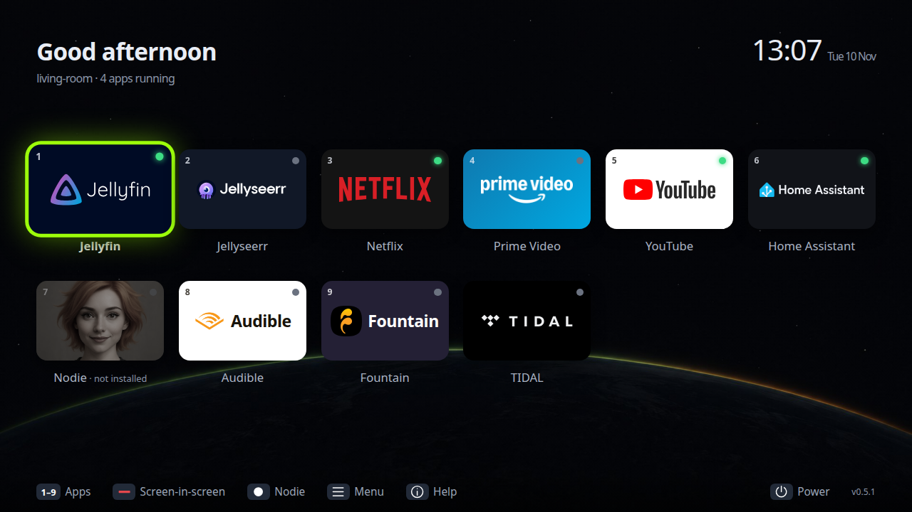 | 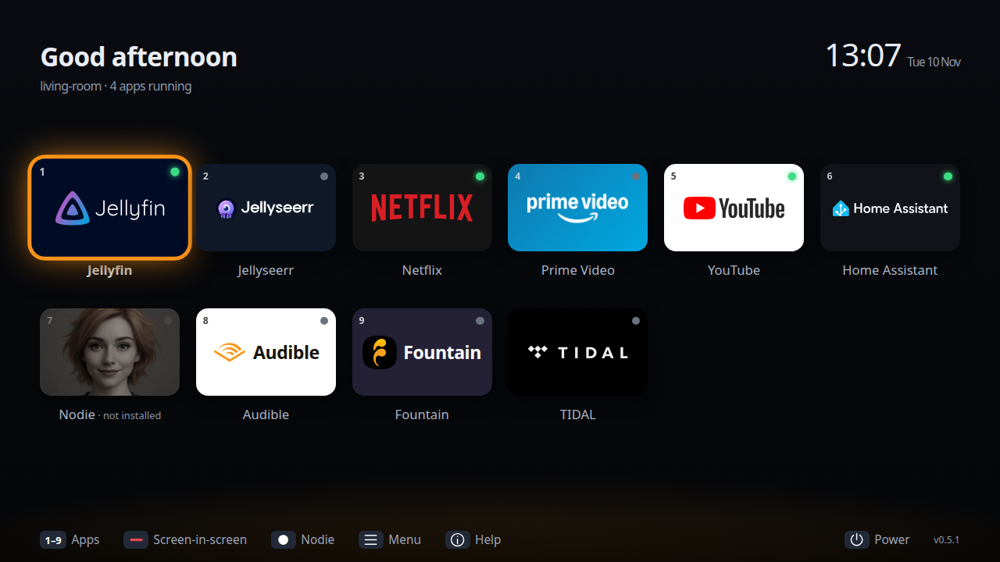 | 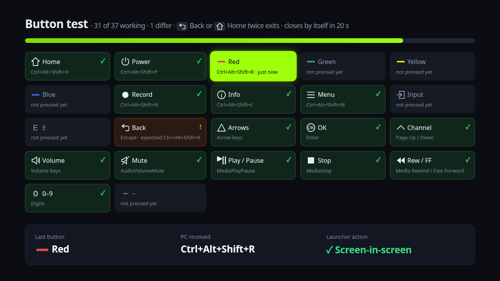 |

| Docker containers | Docker tile on Home |
|---|---|
| 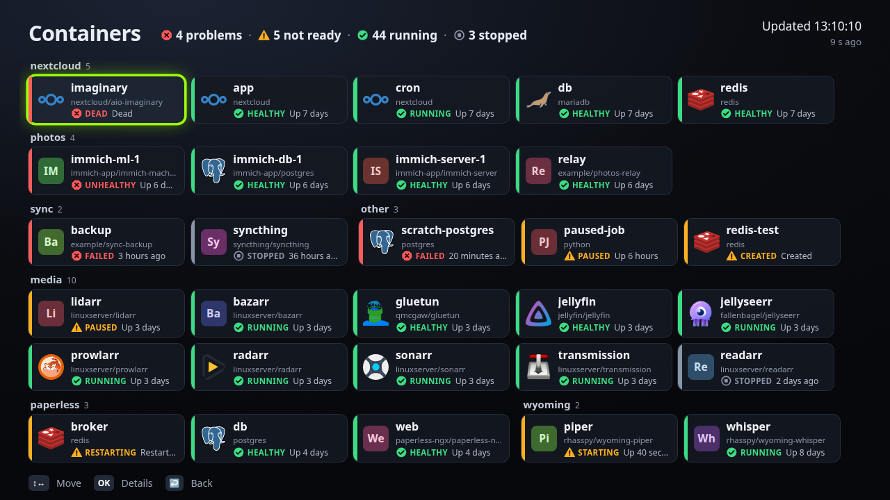 | 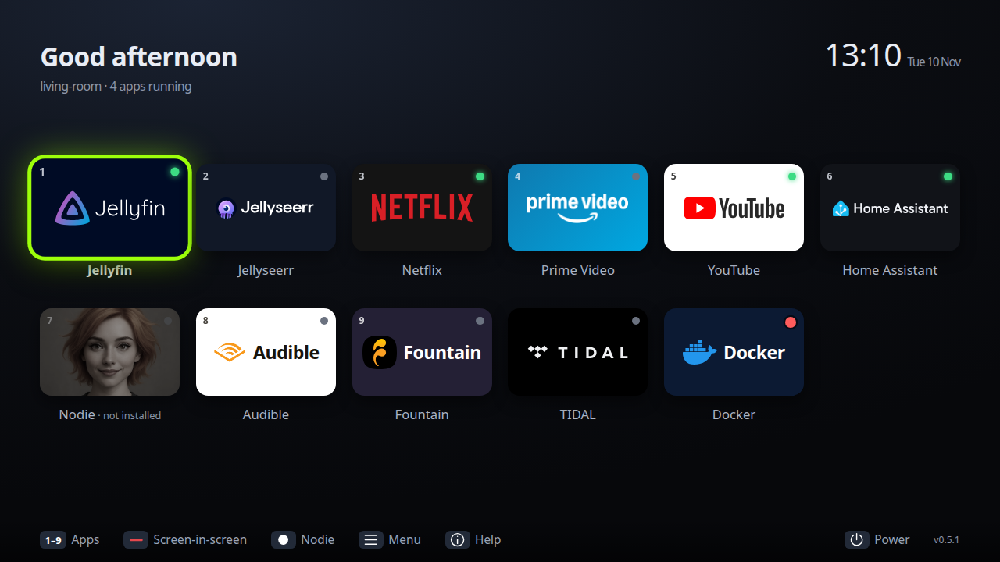 |

See [PLAN.md](PLAN.md) for the design and [docs/keymap.md](docs/keymap.md) for the remote's key map.

## Develop (a development PC)

```bash
npm install
npm run dev          # windowed, hot reload (dev only: --no-sandbox)
npm run check        # typecheck + unit tests
npm run screenshot   # regenerate docs/screenshots (demo data)
npm run dist:deb     # build release/sofa-launcher_<ver>_amd64.deb
```

Demo mode (`--demo`, `--screenshot=…` or any `--demo-…` flag) is safe on a workstation:
it uses built-in demo settings, lists only fictional stand-in games (`--demo-games`),
never reads the machine's Steam library or downloads art, and never launches, closes
or signals a real app.

Settings live in `~/.config/sofa-launcher/config.toml` (created on first run).
While it runs, the launcher claims the remote's Ctrl+Alt+Shift+letter keys
globally, on a development PC too.

## Install (the TV PC)

1. **Administrator**: `sudo scripts/install-system.sh sofa-launcher_<ver>_amd64.deb <sha256>`
   (verifies the checksum, installs to `/opt/sofa-launcher` with its AppArmor profile).
2. **TV user**, in the TV session: `sofa-launcher --self-check` must print `"ok": true`.
   Run `sofa-launcher --setup-user` once as the TV user to start the launcher at login.
   Then start *Sofa Launcher* from the menu. To remove autostart, run
   `sofa-launcher --undo-user-setup`. Existing autostart files are left unchanged.

## Remote (M2)

| Button | Does |
|---|---|
| Arrows / OK | Move / open |
| 1–9 | Open tile 1–9 (home screen and panel) |
| Back | Home: return to the last app · Panel: back to the app · Guide / menus: close |
| Home | Always opens the full home screen |
| ☰ Menu | Home: Settings (button test · remote guide · theme · background · edit home screen · about · quit completely) · in an app: the panel |
| ⓘ Info | Remote guide for what's on screen now; Back or Info closes it |
| Power | Power menu: close launcher / log off (confirmed) / screen off / cancel |
| ● Record | Nod.ie talk |
| Red | Choose the main and inset apps; stop screen-in-screen when active |
| Green | Switch remote controls between the main and inset apps |
| Yellow / Blue | Move the inset to the next corner / change its size |

Toasts appear in their own always-on-top window, so they show over a playing app.
Switching apps pauses the one you leave (MPRIS). If an app the launcher opened
loses all its windows, the home screen comes back.

Opening an app from Home shows a black cover until its window is active and
fullscreen, with an eight-second timeout for slow or nonfullscreen apps.

Jellyfin starts with its native TV interface in fullscreen. For desktop apps or
websites without arrow navigation, choose **Menu → Remote pointer**. Arrows move
the cursor (hold to accelerate), OK clicks, CH +/− scroll, and Back exits pointer
mode. Home, Menu and changing the focused window also release pointer controls.

Closing or quitting Sofa closes apps opened or brought forward through Sofa in
that session, including Nod.ie. Apps never opened through Sofa remain untouched.
Set `keepOnClose = true` on an app to keep it running explicitly.

On Home, Down from the last tile row enters the bottom controls. Left/Right
select Screen-in-screen, Nodie, Menu, Help or Power; OK activates the selected control and
Up returns to the app grid. Back from Nodie's main window returns to Sofa Home.

Select a text field in an app, then press **Input** (or **Menu → Keyboard / mic**).
The keyboard keeps numbers above the letters, switches between letters and
symbols, and includes Space, Delete, Mic,
Type text and Cancel. Dictation is opt-in, stops after 15 seconds, and sends audio
to the local Whisper endpoint at `127.0.0.1:8100`. Review the transcription before
choosing Type text. Closing the keyboard releases the microphone. The microphone
hardware path still requires a person to test it; synthetic speech verified that
the local transcription service responds.

Audible opens the UK library and its Cloud Player; override its URL for a
different marketplace. Fountain opens its listener feed at `fountain.fm/feed`.
Both use the same per-app persistent-profile arrangement as the other web apps.

Prime Video, Netflix, Audible and Fountain use Sofa's bundled navigation
extension in their dedicated browser profiles. Arrows select controls and title
cards, OK opens them, and a bright outline identifies the selection. Moving the
mouse restores the pointer. Video-player keys and text editing stay native.
YouTube keeps its own TV interface. Set `remoteNavigation = false` on an app to
disable the extension for that app.

The extension has no extension API permissions or background process and is
restricted to the listed streaming-site domains. Sofa enables browser developer
mode only in these separate profiles, while the browser is stopped, to load the
bundled extension. Existing profile preferences and login storage are preserved;
the user's ordinary browser profile and password-manager extensions are not changed.
The production launcher does not open a browser debugging port.

For a graceful service/deployment restart, run `sofa-launcher --quit`, then start
`sofa-launcher` again. Power → Close hides Sofa after closing the session's apps;
Home/Power can reopen it while it remains resident.

Device evidence and remaining acceptance checks are recorded in
link:docs/TV_ACCEPTANCE.adoc[TV acceptance checks].

## Edit home screen

Choose **Menu → Edit home screen** to show or hide tiles with the remote. It
lists three sections, **Apps**, **Games** and **Cameras**, as a grid of tiles
with each item's own artwork and name:

- A **tick** in the corner means the tile is on the home screen; a faded, grey
  tile with an **empty circle** is hidden.
- Arrows move across a section and between sections; **OK** shows or hides the
  selected tile, and the home screen behind changes at once. **Back** returns to
  Settings. Reordering is not possible here (the order is `config.toml`'s).
- **Apps** lists every catalogue app (except games), whether or not `config.toml`
  mentions it, plus your own apps. A switched-on catalogue app behaves like any
  other: it opens, appears in the slide-up menu and takes the next 1–9 number
  after the apps from `config.toml`. Apps whose program is missing are marked
  **Not installed** and can't be switched on. Home Assistant and Jellyseerr are
  marked **Needs setup** until `config.toml` gives them their address.
- **Games** lists configured games and every installed Steam game (those in
  `[games] hidden`, or all of them with `enabled = false`, start hidden).
- **Cameras** lists the camera grid and each camera; without cameras it says how
  to add them.

Ten tiles fit across, and about five rows: thirteen apps, a row of games and up
to nineteen cameras fit without scrolling. Beyond that the list scrolls under a
fixed title, keeping the selected tile in view.

Hidden tiles also leave the slide-up menu and the screen-in-screen chooser, as
`hidden = true` does. A hidden camera (or app) can still be opened by its id,
for example by `sofa-launcher open`.

The choices are saved in `~/.config/sofa-launcher/home.json`, never in your
hand-edited `config.toml`:

```json
{ "version": 1, "hidden": ["netflix", "steam-552990", "camera-front-door"], "shown": ["disney"] }
```

Ids are the launcher's own: the app id, `steam-<appid>`, `camera-<id>` or
`all-cameras`. A choice in `home.json` wins over `config.toml` (including over
`hidden = true` and `[games] hidden`); only choices that differ from
`config.toml` are stored, so switching a tile back forgets it. The file is
written atomically with mode 600. A missing or damaged file just means "no
choices" and never stops the launcher; ids it doesn't know (a game that is
uninstalled for now) are kept and ignored.

## Games

The home screen gets a **Games** row, between Apps and Cameras, as soon as there
is a game to show. Games have no 1–9 number, and they are left out of the
slide-up menu and the screen-in-screen chooser. With games but no cameras, the
apps keep their grid (six to a row, up to two rows) with the Games row below,
scrolling sideways when it has more than six games; with more than twelve apps,
every row becomes a single sideways-scrolling line as with cameras. With games
and cameras both present, the tiles shrink so all three rows fit; each row
scrolls sideways.
Up/Down move between rows (to the same position in the next row, or its last
tile), Left/Right along a row, and Down from the last row reaches the bottom
controls.

**Steam games** are found automatically: the installed games of the logged-in
user, read from their own Steam folder (`~/.local/share/Steam`,
`~/.steam/debian-installation`, `~/.steam/steam` or `~/.steam/root`) and every
Steam library listed in its `libraryfolders.vdf`. Libraries on a drive that is
not mounted are skipped. Most recently played come first. Each Linux account
has its own Steam folder and its own `config.toml`, so each account sees its
own games with no extra setup. The tile shows the game's header picture,
filling the tile. The list is re-read when the config changes and when Home is
shown (at most every 30 seconds).

Steam's own artwork cache can hold an event or collaboration banner instead of
the game's normal picture, so Sofa downloads each game's official store header
picture from Steam's image server (`shared.cloudflare.steamstatic.com`, then
`cdn.cloudflare.steamstatic.com`) into `~/.local/share/sofa-launcher/game-art/`
and uses that file from then on. Until it arrives (or if it can't be fetched)
the tile shows Steam's cached artwork, or the game's name when there is none.
This is the one case where drawing a tile contacts an outside
service, and all it sends is the game's public Steam number (in the address;
no cookies or account details). Only JPEG or PNG pictures up to 2 MB are
accepted, each request gives up after five seconds, and a game whose picture
couldn't be fetched is retried at most once a day. Switch it off with
`fetchArt = false`; then no requests are made at all and the tile shows
Steam's cached artwork.

Steam's own tools (Proton, the Steam Linux Runtimes, Steamworks redistributables)
are left out. Other non-game entries, such as soundtracks, VR utilities or
Wallpaper Engine, cannot be told apart reliably: hide them by Steam app id
(the number in the game's Steam store URL):

```toml
[games]
enabled = true                      # false: Steam games start hidden (Edit home screen can show some)
hidden = ["431960", "468020"]       # Steam app ids to leave out
fetchArt = true                     # false: never download artwork from Steam (use Steam's cached copy)
```

**Your own games**: mark any app with `group = "games"` to put it in the Games
row instead of Apps (`group = "apps"` moves it back). Configured games come first,
in config order, then Steam games. The catalogue has Roblox, which runs through
the [Sober](https://sober.vinegarhq.org/) Flatpak (`org.vinegarhq.Sober`):

```toml
[[apps]]
id = "roblox"
catalogue = "roblox"
```

OK on a Steam game runs `steam -silent -applaunch <appid>` (Steam is found on
`PATH`, then `/usr/games/steam` and `/usr/bin/steam`; without it there are no Steam
games). Home returns to the launcher and leaves the game running untouched:
games are never sent a pause command or a key when you switch away, and OK on
the tile again brings the same game back. Games get up to two minutes to show a
window (updates, shader compilation) before Sofa says the game didn't open.

Known limitations of this first version:

- Sofa recognises a Steam game's window by the class Proton gives it,
  `steam_app_<appid>`. Linux-native games use their own window class, so Sofa
  does not see their window: after two minutes it reports that the game didn't
  open (while it may be running), the running dot stays off, and OK runs
  `steam -applaunch` again (what Steam does then is untested).
- Roblox's window class is assumed to be `sober`; it still has to be confirmed
  on the TV (`xprop WM_CLASS` while Sober is open). Override with `wmClass = "..."`.
- **Close** on a game (slide-up menu, or closing the launcher) sends SIGTERM to the
  process that owns the game's window, as for other desktop apps; it never signals
  Steam itself. Whether every game exits cleanly on SIGTERM (and saves) is untested.
- Not yet tested on the TV with a real game: launching, whether the remote's Home
  reaches Sofa while a full-screen game holds the keyboard, and how a game behaves
  when it loses focus.

## Docker containers

The **Docker** tile opens a full-screen view of the TV PC's containers: one card per
container with its icon, name, image and status, grouped under a heading per
compose stack, problems first. Arrows move, **OK** shows details (status text,
state, stack, service, image, container id), **Back** closes the details and then
the view. The view re-reads the status every 10 seconds while open; the tile's
dot (red if anything is red, else amber if anything is amber, else green) is
refreshed at most once a minute while Home is on screen.

| Colour | Word on the card | Meaning |
|---|---|---|
| 🔴 red (✕ octagon) | unhealthy · failed · dead | running but its health check fails; exited with an error code; dead |
| 🟠 amber (! triangle) | starting · restarting · paused · created | not ready yet, or held |
| 🟢 green (✓ circle) | healthy · running | running and healthy, or running with no health check |
| ⚪ grey (■ ring) | stopped | exited with code 0, 137 or 143: what `docker stop` / `compose down` leave |

Set it up in `config.toml`:

```toml
[[apps]]
id = "docker"
catalogue = "docker"

[containers]
file = "/var/lib/docker-status/containers.json"   # absolute path
```

Without `[containers]` the tile shows **not set up**.

**Why a file, not Docker:** the launcher runs as the unprivileged TV user, and Docker
access is root-equivalent. Even a read-only Docker API proxy is not safe:
`GET /containers/{id}/json` returns every container's environment variables,
including secrets. So a system service on the TV PC writes just the fields the
view needs to a JSON file the TV user can read, every 15 seconds (atomically); the
launcher only reads that file. It never talks to Docker.

The file is a JSON array of
`{"Id", "Names", "Image", "State", "Status", "Health": {"Status"}, "Project", "Service"}`
(the Docker Engine API's names; `Project` and `Service` are the compose labels,
empty when not set). It is treated as untrusted: at most 2 MB and 500 entries,
every field validated and length-capped, unknown fields ignored. If a read fails
(missing, unreadable, invalid JSON), the view keeps the last good data, greyed,
with the error. If the file is more than a minute old, the view says the status is
stale: its writer may have stopped. Either way the tile's dot is at least amber.

Stacks whose names share a first word with another stack are shown together
(`t3-stack`, `t3-host-relay` → **t3**); containers without a stack go under
**Other**. Inside a stack, cards drop the stack's prefix (`nextcloud-db` → `db`).
Icons come from [dashboard-icons](https://github.com/homarr-labs/dashboard-icons),
bundled with the app (never downloaded at run time); a container without one gets
a two-letter monogram.

The packaged AppArmor profile is electron-builder's `flags=(unconfined)` profile
(it only adds `userns` for Chromium's sandbox), so it does not restrict which files
the launcher reads. Ordinary file permissions apply: the TV user must be able to
read the file.

`--demo-screen=containers` shows the view with 85 fictional containers;
add `--demo-containers-error` for the unreadable/stale state and `--demo-docker` to
put the tile on the demo Home.

## Screen-in-screen

Choose **Screen-in-screen** on Home or in the app panel, select the main app,
then select a different app for the inset. Both keep running; **Green** switches
which one receives arrows and OK. **Yellow** cycles corners and **Blue** cycles
30%, 40% and 50% inset widths. **Red** stops and restores both windows. Open
Screen-in-screen again for named controls or to choose a different pair.

This resizes the original app windows, preserving their browser profiles and
rendering paths. It requires X11 and Python 3. Window-management checks passed
on the TV PC's KWin with temporary native windows; real-service playback and
DRM compatibility still need device testing. See
[the implementation and test notes](docs/SCREEN_IN_SCREEN.adoc).

Camera insets stay pinned above Home and newly opened apps. Sofa temporarily hides
the inset while its panel, toasts, menus, logout confirmation or remote guide are open,
then restores it without taking focus. Edge popups can still appear beneath the
inset; Sofa cannot detect external browser menus. Opening an app
changes the base while keeping the camera, corner and size in memory until you
press **Red** or choose **Menu → Screen-in-screen → Close second screen**.
The pinned viewer never takes keyboard focus; the remote controls the foreground
app. Camera insets cannot be selected for remote input or expanded for browsing.
Closing the base app keeps the camera pinned. Selecting its own tile shows
“Already pinned”. Closing Sofa removes the inset. Nothing is restored after restarting Sofa.

App-as-inset pairs also remain active on Home, though Sofa covers them. Opening a
different app ends the pair and restores both windows. Only Sofa's own isolated
Home Assistant camera viewer supports pinning across app switches.

Camera viewers request a still through Home Assistant's authenticated camera proxy
while live video connects, then fade to live video on the first decoded frame.
A failed still request leaves the usual connecting/error display. Credentials stay
in the main process and authenticated request headers; snapshots reach the viewer
as JPEG data URLs. Camera signaling sockets remain scoped to individual sessions.

Camera tiles on the home screen show each camera's latest still through the same
proxy (a small, about 480 px wide JPEG), fetched when Home appears and about once
a minute while it stays in front, a few cameras at a time; nothing is requested
while an app is in front or before Home Assistant is connected. Cameras with a
still come first in the Cameras row (after **All cameras**), in config order; a
camera whose still can't be fetched keeps its icon. The row only reorders while
the remote isn't on it, so the selected tile never jumps.

## Browser configuration

Web apps use a Chromium-based browser: Edge, Chrome, Chromium, Brave or Vivaldi.
Choose **Menu → Browser** to use the system default or an installed browser.
The choice is saved in `config.toml` and applies to apps opened afterwards;
already-running apps stay open. Flatpak and Snap browsers are not supported
(on Ubuntu, `chromium-browser` is a Snap; use Edge, Brave, Vivaldi or a Chromium .deb).
Firefox can't be used: web apps rely on Chromium's app windows and per-app profiles.

```toml
[ui]
browser = "default"  # default, edge, chrome, chromium, brave or vivaldi
```

`default` reads `xdg-settings get default-web-browser`. If that browser is not
supported or installed, Sofa uses the first installed of Edge, Chromium, Brave,
Vivaldi, then Chrome.

Google Chrome is the last choice: since Chrome 137 it may ignore the command-line
option that loads Sofa's remote helper (arrow navigation in Netflix and Prime Video,
and Back to Sofa home), so a Chrome system default is only used when nothing else is
installed. Choosing Chrome explicitly still works, but those features may be missing.
The deprecated `defaultBrowser = "edge"` is accepted when `browser` is absent.
An app can set `browser = "chrome"` (or any choice above) to override `[ui]`.

Each app has its own persistent profile under `~/.local/share/sofa-launcher/`:
Edge keeps `profiles/<appId>` for existing logins; other browsers use
`profiles/<browserId>/<appId>`. Switching browsers keeps their logins separate.

The catalogue's `edge` id opens the selected full browser with tabs and an address
bar, starting on its new-tab page. Its name and artwork follow the browser choice.
Switch it on in **Edit home screen**, or add:

```toml
[[apps]]
id = "edge"
catalogue = "edge"
```

It keeps its own profile and `sofa-edge` window class. Back sends Alt+Left.
The full browser starts maximised so its toolbar stays visible. The desktop
taskbar may remain visible, depending on desktop settings. The remote pointer
and on-screen keyboard work as in other apps.

## Home Assistant configuration

New installs use `http://homeassistant.local:8123`. Change the Home Assistant
app's `url` in `config.toml` to your own address, for example
`http://192.168.1.50:8123` or `https://ha.example.com`. Camera inputs can also use
`[homeAssistant] url` for their shared connection. Existing configs are preserved.

Web URLs accept HTTPS anywhere. Plain HTTP accepts `localhost`, `127.0.0.1`,
canonical private IPv4 addresses in `10.0.0.0/8`, `172.16.0.0/12` and
`192.168.0.0/16`, and hostnames ending in `.local`, `.lan`, `.home.arpa` or
`.internal`. Public HTTP hosts, IPv6 HTTP, userinfo and alternate numeric IP
spellings are rejected. Camera connections use `ws://` for HTTP and `wss://`
for HTTPS. The browser navigation extension remains restricted to HTTPS
streaming sites.

## Local control

```bash
sofa-launcher open netflix                      # open or bring forward
sofa-launcher open youtube --search "Bluey"     # open at the search results (fresh start only)
```

The running launcher receives the command (single-instance). `--search` works
for Netflix, Prime Video and YouTube when the app isn't already open; desktop
apps ignore it. The text is limited to 200 printable characters.

## Appearance

Choose **Menu → Theme → KnowAll green / Nod.ie orange** with the remote.
The choice is saved as `[ui] theme = "knowall"` or `"nodie"` in
`~/.config/sofa-launcher/config.toml`; edits reload live in the home, panel and toast windows.

Choose **Menu → Background** for the home screen backdrop, from a grid of
thumbnails (arrows move, OK chooses). There are eighteen, all
dark and quiet: gradients and glows (`midnight`, `corner-glow`, `horizon-glow`,
`brand-wash`, `dot-grid`, `near-black`), pictures (`horizon`, `ribbons`,
`smoke-left`, `smoke-right`, `nebula`, `planet`) and stage pictures with
silhouettes (`pavement-lights`, `glove-and-hat`, `toe-stand`, `moonlit-night`,
`stage-lean`, `moonwalk`). Corner glow and Horizon glow
follow the theme colour. The choice is saved as `[ui] background = "planet"`.

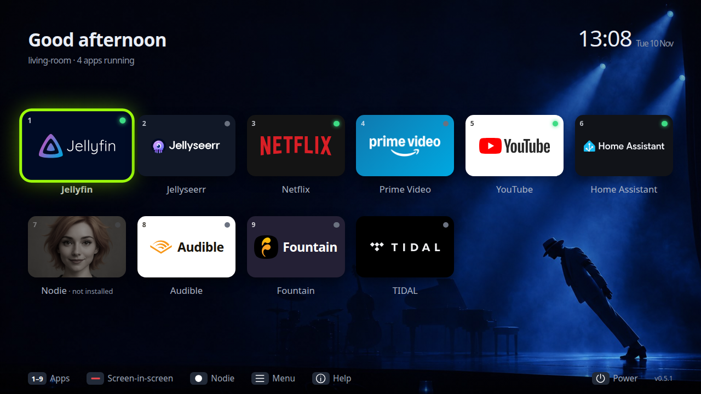

Web apps accept HTTPS and local-network HTTP as described in Home Assistant configuration.
The initial Jellyseerr tile uses `http://127.0.0.1:5055` on this PC.

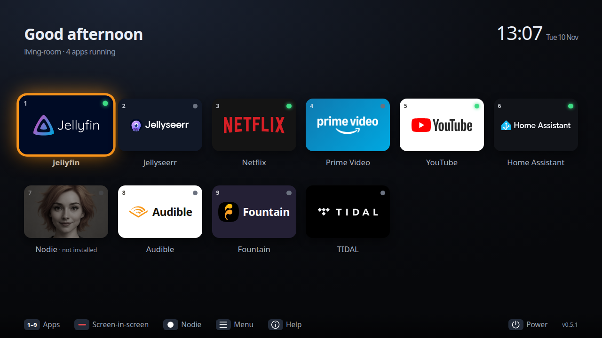

## Releasing

Bump the version in `package.json` and `package-lock.json`, review and merge the
change, then tag the merged commit:

```bash
git tag vX.Y.Z && git push origin vX.Y.Z
```

The tag must match `package.json`. The release workflow checks the code, builds
the Debian package, and attaches the `.deb` and `SHA256SUMS` to the GitHub Release.

On the TV PC, **an administrator** keeps a reviewed copy of
`scripts/install-system.sh` in an admin-owned location such as
`/usr/local/sbin/sofa-install`. Download the `.deb` and read its SHA256 from the
Release page through the administrator’s own browser or `gh` session. Install using that
independently obtained checksum:

```bash
sudo sofa-install sofa-launcher_<ver>_amd64.deb <sha256>
```

On first run, the **TV user** checks the sandbox and then sets up autostart:

```bash
sofa-launcher --self-check    # must print "ok": true
sofa-launcher --setup-user
```

Screen-in-screen also has separate named audio menus for the main and inset app.
Green selects the app for remote input; Sofa tries to route Volume +/− and Mute
to that app while the pair is active. If KDE owns these keys, use the named audio
menus instead (the physical volume keys retain system control). Nodie pairs add
camera, listening and voice-output toggles; these are separate controls.

## Contributing and security

See [CONTRIBUTING.md](CONTRIBUTING.md) for how to contribute. This is a public repository, so **never commit secrets or personal details**. To report a vulnerability, see [SECURITY.md](SECURITY.md).

## Licence

Sofa Launcher is released under the [MIT License](LICENSE).

Streaming-service names and logos shown in the app and screenshots are trademarks of their owners; they are used only to identify each service and are not covered by the MIT licence.
