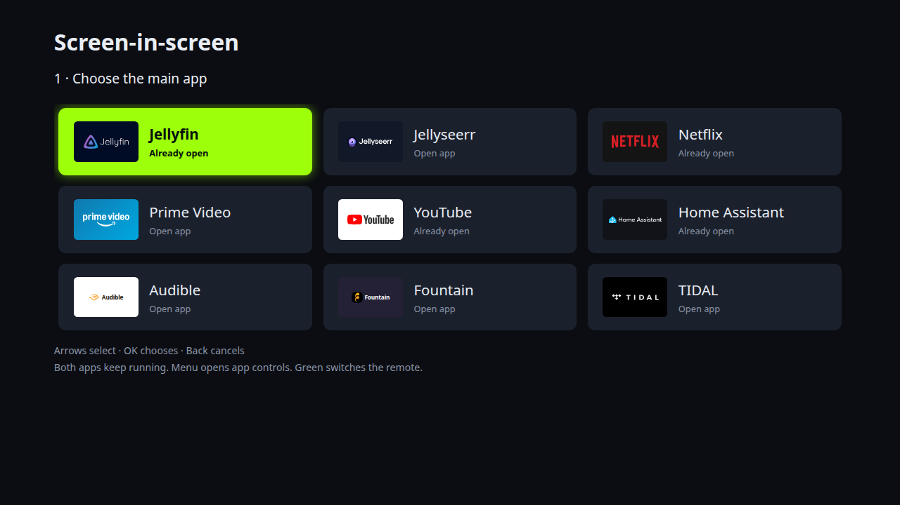
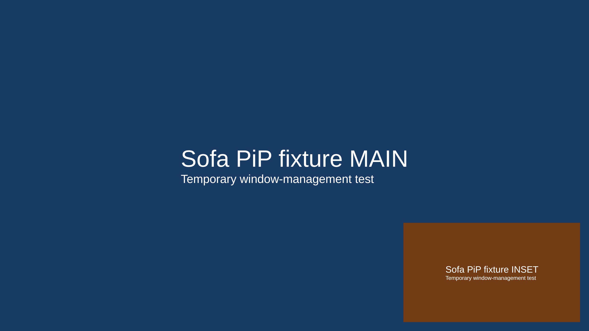
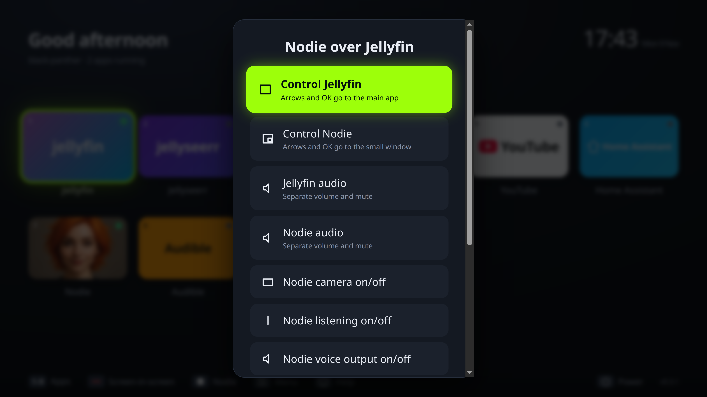
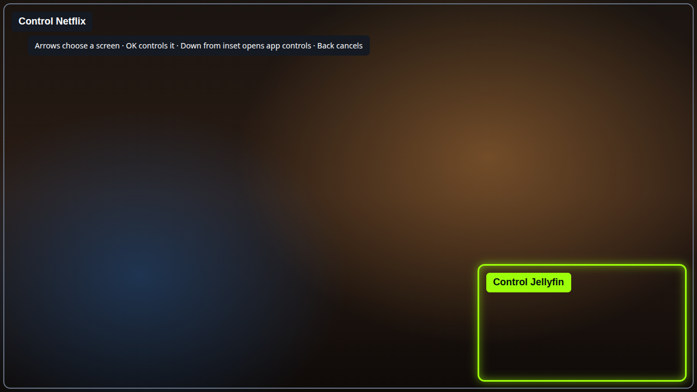

= Screen-in-screen

Select Screen-in-screen from the Home footer or the in-app panel. When opened
over an app, that app is used as the main screen: choose only the second app.
From Home, choose a main app and then a different inset app. Apps can already be running or can be launched
from the chooser. Existing browser profiles are used.

[cols="1,3",options="header"]
|===
|Remote |Action
|Red |Open the chooser; when a pair is active, stop it and restore both windows
|Green |Switch arrows and OK between the main and inset app (the toast names it)
|Yellow |Move the inset between the four corners
|Blue |Cycle 30%, 40% and 50% screen widths; constrain to the display height
|Menu |Open Sofa's panel over the app; Screen-in-screen has named controls
|Home |Show Sofa Home while keeping the selected pair running
|===

Choose Screen-in-screen again to control either named app, move, resize, stop,
or choose a different pair. Menu first opens the visible bottom app panel;
Up enters spatial screen selection. Close second screen closes only the inset
app and returns to the main app. Stop restores both app windows instead.
For app-as-inset pairs, selecting a different app tile ends the pair before
opening that app. Home keeps the pair running behind Sofa. Closing either selected app, closing Sofa, or quitting Sofa
restores the surviving windows. If an app explicitly enters fullscreen again,
Sofa ends the pair instead of repeatedly fighting the app's fullscreen state.

The legacy config action keys `cameraToggle`, `cameraNext` and `cameraCorner`
remain accepted, so existing Flirc and `[buttons]` mappings need no reprogramming.
They operate both app pairs and pinned Home Assistant camera viewers.

== Window ownership

The implementation operates on two selected X11 windows. It does not capture,
transcode or embed their pixels. Both apps retain their own video rendering,
login state and permissions. App opening suppresses Sofa's usual MPRIS pause
handoff for the pair. Audio remains under the apps' existing controls.

The adapter uses Python 3 standard-library `ctypes` with system `libX11`; the
Debian package declares Python 3 as a dependency. All commands use argument
arrays with bounded timeouts. IPC accepts configured app IDs and a fixed set of
controls, not arbitrary window IDs or shell commands.

Before any changes, Sofa records client geometry, fullscreen/maximized/above/
below states, Motif decorations, transient parent and owner PID. It temporarily
makes the main app borderless and screen-sized and makes the inset borderless,
keep-above and transient for the main window. That keeps the inset above the
main app even when the main app receives keyboard focus. This avoids KWin's
active-fullscreen layer covering an ordinary keep-above inset.

Stop restores the recorded properties and geometry. Maximization is restored
before fullscreen, which preserves KWin's pre-fullscreen maximized state.
If one app closes, restoration is still attempted for the survivor. PID checks
prevent restoring a window ID that X11 has reassigned to a different process.

== Verification on the TV PC, 2026-11-09

Unit checks cover setup rollback, serialized stop, closed/replaced windows,
fullscreen re-entry, focus, corner/size cycling, bounds and preserving both
players during app opening. The real Svelte chooser is exercised by the
`--demo-screen=pip` screenshot workflow: arrows/OK choose the main app, that app
is excluded from inset choices, and Back returns to main-app selection.

KWin/X11 device checks used two temporary Electron windows with no service
credentials. Tests checked X11 stacking order after returning focus to the main
window, focused-window identity in both directions, resizing/corner movement,
and exact round-trip geometry, fullscreen/maximized states, decorations and
transient parent. Both an initially maximized pair and an initially fullscreen
pair passed. Temporary windows were then closed. These prove window management,
not Jellyfin, Edge, Netflix, Prime Video or other service playback compatibility.

[cols="1,1",options="header"]
|===
|Before: temporary windows are fullscreen separately |After: inset remains above the focused main window
|
|
|===

== Remaining device acceptance

Run the normal build through Sofa with a native app and an Edge app. Confirm
both window roles, remote selection/control, Home/panel return, all corners and
sizes, restoration, window-close recovery and audio behavior. Test real video
playback separately for each service before claiming support. A service may
pause or restrict playback when resized or unfocused, and an app may enforce a
minimum window size. Sofa's selected-app transport routing now owns global
Play/Pause/Stop and routes them to the selected app.

== Independent audio and Nodie controls (0.3.1)

Green selects which app receives arrows/OK. While a pair is active, Sofa also
tries to claim Volume Up, Volume Down and Mute for that selection. Each action
changes only PulseAudio/PipeWire playback streams belonging to that app's process
tree or exact Flatpak app ID; it does not change the output device/master volume.
Volume steps are 5%, capped at 100%, and mute is independent for each app.

KDE or another program may already own these keys. If Sofa cannot claim all
three, it releases any partial grabs and explains that the physical volume keys
still control the system. In either case, open Screen-in-screen and choose the
named app's audio controls to adjust its volume/mute explicitly. An app with no
playback stream yet is labelled accordingly. Play/Pause targets the selected app through Sofa.

When Nodie is in the pair, the menu also offers camera on/off, listening on/off,
and voice output on/off. Each choice focuses Nodie and invokes its own local
control. The camera, listening and speaker controls are separate: muting Nodie
never implies its microphone or camera is off. Nodie displays its actual control
state; Sofa's menu labels are toggle actions, not a cached state indicator.
These shortcuts require the companion Nodie remote-controls update.

Verification: 257 unit tests and the browser checks pass. A separate device test
used two silent pacat streams on the TV PC: reducing one and muting the other
left the other stream and master unchanged, then unmute was verified. This live
test is gated by SOFA_AUDIO_DEVICE=1 and is skipped in normal CI. Nine targeted
Nodie tests pass, including named camera/mic/speaker shortcut dispatch without
starting real camera or microphone hardware. The TV session was locked, so the
new menu, physical volume-key grabs and real app/Flatpak stream matching still
need on-screen acceptance. No lock-screen bypass was attempted.

== Directional screen selection (0.3.2 preview)

With a pair active, Menu opens an outline over both app windows. Arrows toward
the inset select it; OK sends input to that app. Opposite arrows select the main
screen. Down from the selected inset opens Sofa's ordinary app panel, and Up from
the tile row returns to screen selection. Back cancels. This avoids requiring the
Green shortcut. Arrows inside an app continue navigating that app; they do not
cross window boundaries automatically.

The actual Svelte renderer's `--demo-screen=panel-pip` screenshot check verifies
Right to inset, Down to app controls, Up back to selection, Left to main, and
Right to inset again. It uses demo imagery; native-window handoff still requires
TV acceptance. Nodie device controls currently use focused local shortcuts
invoking Nodie's own controls, not a stateful external API.

After the TV was unlocked, the real Jellyfin/Nodie pair and audio/device menu
were inspected. KDE owns the physical volume keys on this session (its system
volume popup appeared), so separate volume/mute must use the named app-audio
menus. Camera and microphone were left off. Further keyboard testing was paused
because the requested 0.3.1 installer was awaiting sudo authentication in the TV
terminal. The installed system version remained 0.2.0 at that point.

== Browse the second screen at full size

The inset uses the desktop's normal display scale. On a high-DPI TV, its small
window can therefore show a narrow, crowded website layout. Browse second screen
temporarily enlarges that app to the whole display and gives it arrows/OK. It
changes window geometry, without entering the app's native fullscreen mode or
ending the pair. Return to small screen restores the chosen corner and size.

Controlling the main app also shrinks an enlarged inset first, so it cannot
cover the main app after focus changes. Moving or resizing the inset leaves
browsing mode. Stop still restores both apps' original window snapshots, even
when the inset is enlarged. Sofa does not infer that playback has begun; use
the explicit small-screen control after selecting the video.

Backend verification covers full-display browsing bounds, focus, restoration to
an existing size/corner, collapse before main-app focus, move/resize, a failed
activation after enlargement, and Stop queued behind an enlargement. These are
unit checks; the enlarged website layout and remote handoff need device checks.

== Pinned camera viewers

When the inset is Sofa's isolated Home Assistant camera viewer, it stays above
Home and subsequently opened apps. It is hidden while Sofa menus and overlays
are open; toast notifications leave it visible. The latest app becomes the base;
the camera, corner and size stay in memory. Closing the base, via Sofa or
independently, leaves the camera pinned. Red or Menu → Close second screen
removes it, as does closing the camera viewer or quitting Sofa. Without a base,
main-app controls show a notice until another app opens. Green leaves
keyboard input on the foreground window; browsing and inset-focus controls are
hidden for pinned cameras.

The original base window is not resized or made transient. Electron sets the
camera non-focusable and always-on-top at `screen-saver` level. KWin's active
fullscreen layer still outranks ordinary keep-above, so the X11 helper also sets
`_NET_WM_STATE_ABOVE` and `_KDE_NET_WM_WINDOW_TYPE_CRITICAL_NOTIFICATION` on the
camera window only. Unlike KWin's OSD type, this preserves chosen geometry.
The helper waits for fullscreen exit before setting borderless inset bounds.
Home and app switches re-raise the camera without activation. Stop closes this
owned viewer instead of restoring it over Home. App-as-inset pairs continue to
use their existing transient-parent and restoration behavior.

Viewers fetch a still concurrently with live negotiation through the existing
redirect-rejecting, time-limited authenticated camera proxy request. Owner-checked
IPC returns only a JPEG data URL. A decoded Chromium video-frame callback starts
the 250 ms fade. Late/failed snapshots cannot cover live playback, and the 30 s
WebRTC connection timeout and existing errors remain. Signaling sockets remain
per session; sharing authenticated subscriptions was left out of this change.

== Pinned inset verification on a development PC, 2026-11-10

`npm run check` covers camera lifetime decisions, app-pair navigation, non-focusable
window policy, snapshot headers/IPC ownership, demo safety and still-to-live races.
`tests/camera-window.electron.cjs` uses a local synthetic Home Assistant server,
HLS generated by ffmpeg and canvas WebRTC to exercise real Chromium playback,
snapshot-before-live, the completed fade, retry and pause/resume.

`tests/pinned-inset.electron.cjs` briefly opens an isolated unconnected viewer and
two throwaway fullscreen apps plus a fullscreen Home stand-in on the X11 desktop.
It checks EWMH stacking, active-window identity, arrow input, initial geometry,
corner/size changes and close. All fixture windows and temporary profiles are
closed/removed. No real cameras, streaming services or KDE settings are touched.
Actual fullscreen Edge/DRM playback and physical Flirc input remain device checks.
