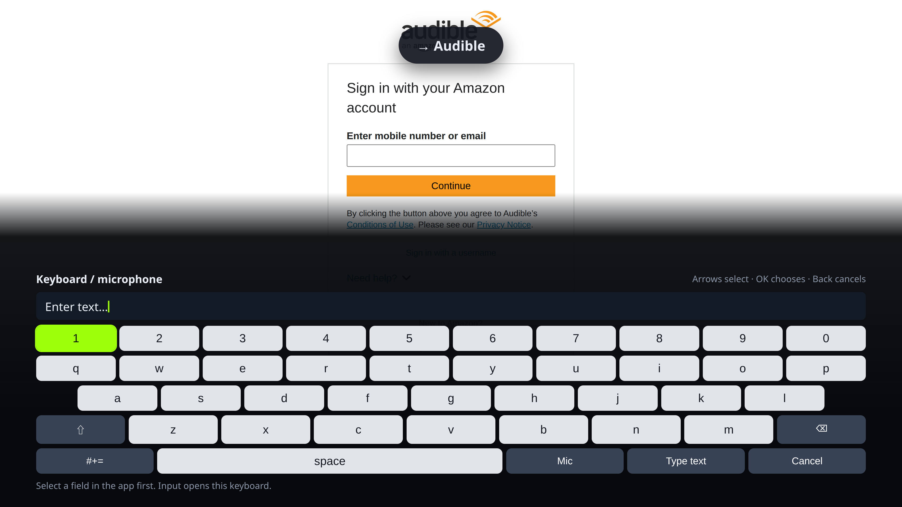
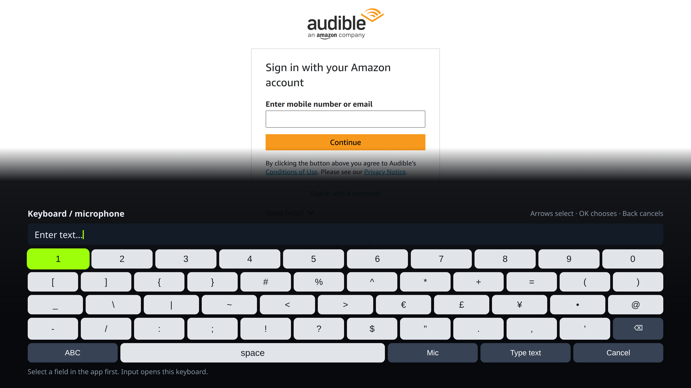
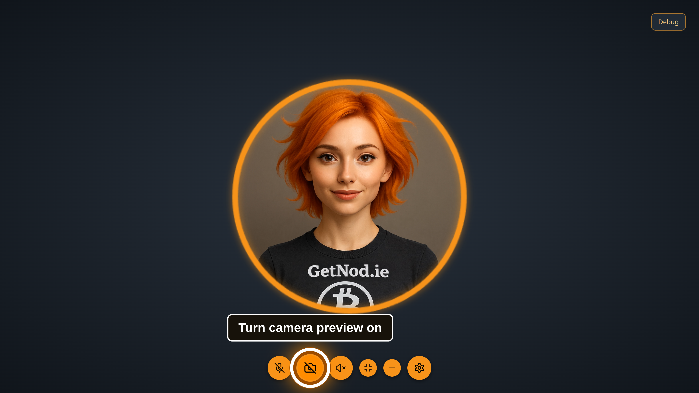
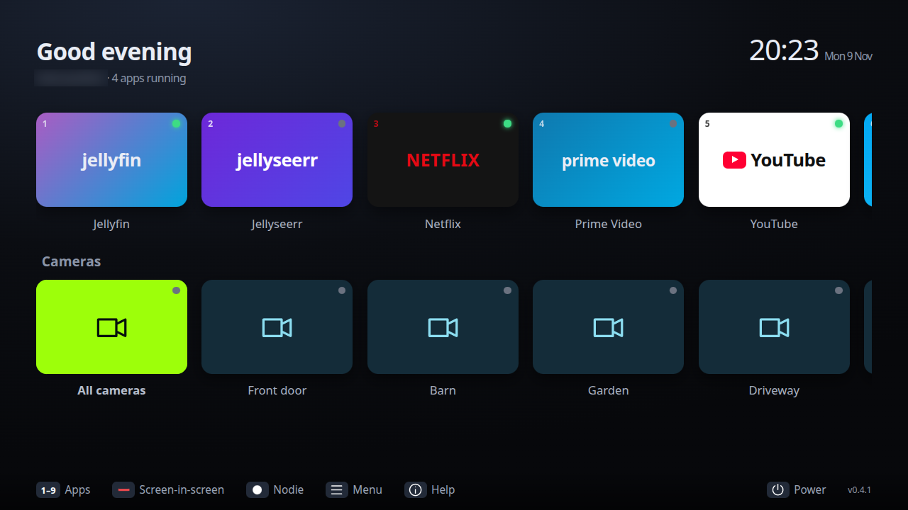
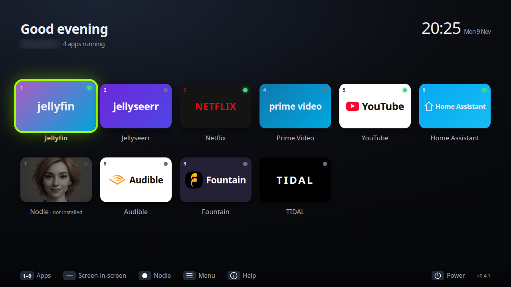
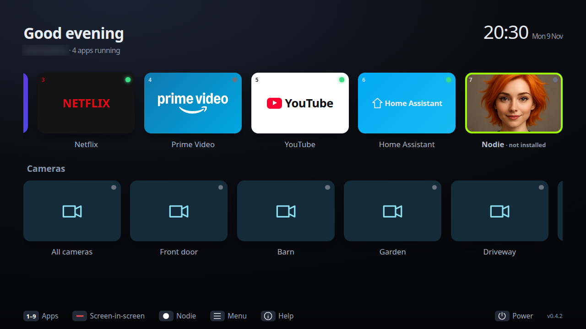

= TV acceptance checks, 2026-11-09

== Build and deployment

Source branch: `fix/tv-session-navigation`. Version: 0.3.0.

`npm run check` passes 253 unit checks and type checking. `npm run test:browser`
passes real Chromium DOM/geometry checks for title cards, row movement, OK,
removed focus, native text editing, form navigation, modal scope, Fountain episode
selection and player pass-through. Those checks use synthetic local HTML and no
service credentials. CI runs them too.

`npm run dist:deb` builds the hardened Debian package, including the browser
navigation extension outside ASAR and the Python 3 dependency for X11 operations.
The package is prepared in the TV PC's Downloads. System installation needs
the desktop user's sudo password. No GitHub release or tag was published.

The live device tests used a development bundle in `/tmp/sofa-emulation-build`
with Nodie's permitted Electron 44 runtime, while the installer contains Electron
45.2.3. This is temporary; the installed 0.2.0 autostart remains until the package
is installed. Do not describe the development bundle as a completed system update.

== Actual device checks

Tests ran on the TV PC's KDE/KWin X11 desktop, 3840 × 2160. Input used
xdotool to send the previously recorded SofaBaton/Flirc mappings, not merely DOM
clicks. These emulate remote keys; a person still needs to confirm the physical
remote's transmission and microphone hardware.

[cols="1,3",options="header"]
|===
|Area |Evidence
|Prime Video |Down selects a title, Right moves to adjacent titles, Down enters
another row, OK opens title details, and mapped Back returns to browsing. This
was tested through Sofa's profile and bundled extension, without a debug port.
|Fountain |Down selects an episode link, OK opens its episode page. Other
buttons and feed rows accept directional focus. No wallet or account operation
was performed. Its public GitHub organisation exposes plugins and integration
skills, not listener-app source; there is no app fork or Fountain PR.
|Audible |Tile opens its Amazon sign-in screen. Library and book playback await
sign-in; they are not marked passed.
|Nodie |TV mode exposes four bottom controls and hides floating/tray controls. Arrows reach microphone, camera, voice mute and Settings. Camera focus shows “Turn camera
preview on”; selected controls have a white ring and visible caption. Mapped
Back from the main screen returns to Sofa Home. Eleven targeted Nodie unit tests and real Chromium settings navigation pass. Fullscreen Settings was checked on the TV. The wider worktree suite lacks dependencies including dotenv, so it is not
reported as passing.
|Keyboard |Input opens the flat keyboard at the bottom. Numbers remain on the
letter and symbol pages. A selected test character was inserted into the actual
Audible text field using “Type text”, then cleared without submitting the form.
The microphone path has only the earlier synthetic local-Whisper check; actual
microphone capture is not verified.
|Jellyfin |Explicit TV display mode persists after relaunch. Arrows and OK open
episode details. Disabling server custom CSS on this client removes the custom
second header. Fullscreen hides the desktop panel. A sample of Friday Night
Dinner, S6E3, played for several minutes without the reported freeze. This is
not a reproduction or resolution of that intermittent issue.
|Screen-in-screen |The normal Sofa chooser opened Jellyfin as main and Fountain
as inset. Green changed the active X11 window, Yellow moved the inset, Blue
resized it, and Menu opened the bottom panel. Testing exposed and corrected a
DIP/physical-pixel mismatch on the scaled TV display. Earlier fixture checks
cover exact geometry/state restoration; real service playback compatibility is
still limited as described in SCREEN_IN_SCREEN.adoc.
|Session close |Power → Close Sofa closed Jellyfin, Nodie, Fountain and Audible
used in that session. A subsequent Home press reopened Sofa with zero running
apps. A newer Home/navigation request now prevents a slow close operation from
hiding Home afterwards.
|===

== Limits to retain during review

The Jellyfin freeze is unresolved. NVIDIA measurements showed active ffmpeg
GPU encoding/decoding while the sample played, but those observations do not
establish the native client's decoder choice or explain the freeze. No switch
to browser playback or server transcoding change was made.

Netflix/YouTube protected playback, real microphone capture, and video playback
in every screen-in-screen pairing still need acceptance. Global media buttons
retain KDE's current media routing, which does not necessarily follow the chosen
inset focus. A service can stop playback when resized or enforce fullscreen.

The Electron 44 development runtime can retain its process lock after SIGTERM
destroys its windows. `--quit` sends a graceful shutdown request through Sofa's
single-instance channel and was verified to release the lock; use it for restarts.
Normal Power → Close remains resident so Home/Power can reopen it. “Quit
completely” and `--quit` require restarting Sofa before the remote can reopen it.

Nodie's previously observed Bitcoin Core/LND update recommendations and Boltz
health-check DNS failure were not changed by the navigation work. Account
migration remains explicitly deferred.

== Inspected screenshots

Screenshots of third-party services (Prime Video directional selection, Fountain
episode focus, a Fountain inset over Jellyfin) were checked during testing but are not
kept in the repository, because they show the services' own artwork and the tester's
library.

== Combined 0.4.0 update

Development PC checks cover apps → Cameras → footer navigation and horizontal
scrolling, current-app inference for the inset chooser, visible Menu panel,
spatial main/inset selection and enlarged inset browsing. The Input and E
legends now describe keyboard/microphone and subtitles respectively. Native
Netflix subtitle/back adapter has Chromium DOM fixture coverage; service-side
behavior remains a device acceptance check after upgrade.

The dedicated HA token was created through the authenticated profile UI and
validated without displaying it in the transcript. Real API discovery found
all nine configured cameras; seven Ring inputs advertise WebRTC. Front door
and Cot were unavailable. The user confirmed camera WiFi setup is pending.
One bounded real Ring attempt reported unavailable with zero decoded frames;
no real camera images were captured. Generated HLS and a real local WebRTC
producer both played through the actual secure Chromium camera renderer and
main-process signaling/media path. This proves the player pipeline, not the
offline devices. Live feed acceptance follows WiFi configuration.

== 0.4.1 follow-up

Development PC: 294 unit tests pass, one hardware-gated skip, clean typecheck,
directional browser fixtures, home/camera/footer screenshot checks, and actual
Chromium HLS/WebRTC fixture playback pass. Camera title retention, default-route
ICE interface policy, one-error candidate overflow cleanup and independent audio
are covered by the camera checks. Real cameras still need WiFi setup.

Home rows now display five larger tiles across when cameras are configured;
Home Assistant remains available. Audible and Fountain show bundled official
symbols with asset provenance. On the TV PC TIDAL's actual redirect to
`tidal.com` was identified; with the updated extension, arrows selected sidebar
and content controls and OK started album audio that advanced beyond ten seconds.
The sample was paused after testing. The installer now uses a detached session
and checks Sofa remains alive instead of only reporting a spawned command.

== 0.4.2 logo/focus follow-up

Prime Video now uses its official wordmark and smile rather than plain text.
Photo tiles previously painted over the home row's inset focus shadow. The
focus border now paints above tile contents, so Nodie has the same green
selection outline as other apps. Development PC typecheck/build and the camera-home
navigation/screenshot check pass, including selecting Nodie after scrolling.

